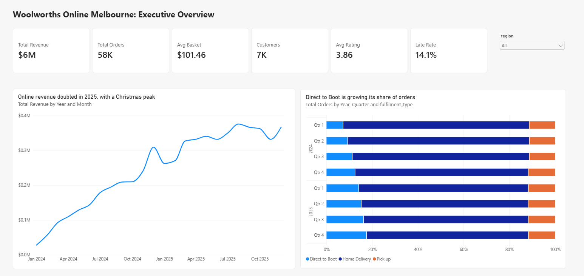
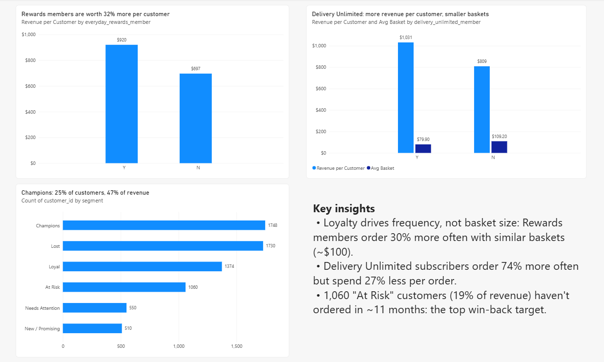
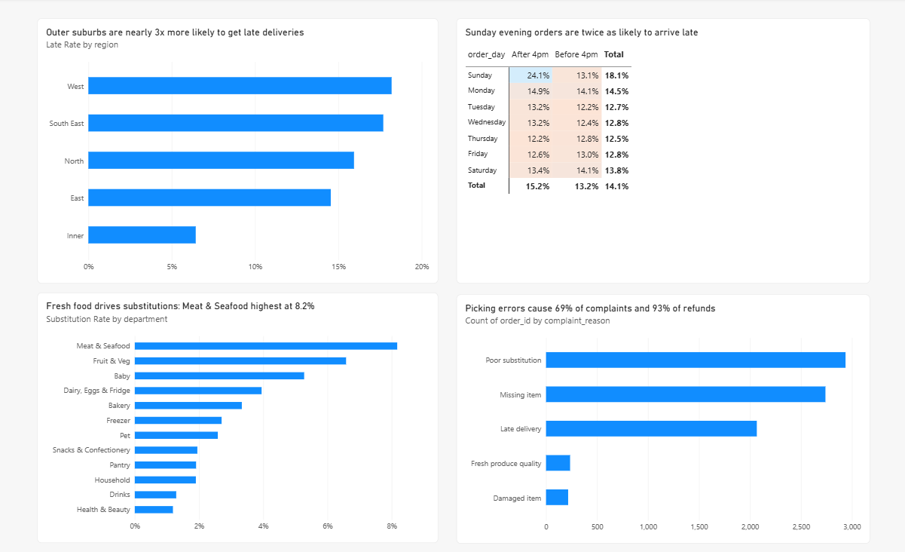

# Woolworths Online Melbourne: Customer Loyalty & Fulfilment Performance Analysis

**Tools:** MySQL 8.4 (MySQL Workbench) · Power BI · DAX
**Skills:** Data cleaning · Relational modelling · Joins · CTEs · Window functions · Customer segmentation (RFM) · Retention analysis · Dashboard design

> **Disclaimer:** This project uses a **simulated dataset** created for a portfolio case study. It is modelled on publicly known features of Woolworths' online service (Everyday Rewards, Delivery Unlimited, Direct to Boot, own-brand range) and uses real Melbourne suburbs. It contains no real Woolworths data and is not affiliated with Woolworths Group.

---

## Business Problem

The Head of Online for a Melbourne grocery retailer wants to know:

1. **Where is online growth coming from?**
2. **Which customers are most valuable?**
3. **Which operational problems are costing us customers?**

## Dataset

7 related tables covering Jan 2024 – Dec 2025:

| Table | Rows | Description |
|---|---|---|
| customers | 7,000 | Suburb, region, age band, Everyday Rewards and Delivery Unlimited membership |
| orders | 59,757 (raw) | Order date, fulfilment type, basket value, fees, promo codes |
| order_items | 683,483 | Products per order, price, discount, pick status (picked / substituted / unavailable) |
| products | 132 | Department, brand type (branded vs own brand), price |
| stores | 10 | Fulfilment stores by region |
| deliveries | 44,071 | Delivery window, actual delivery time, minutes late |
| customer_feedback | 25,462 | Ratings, complaint reasons, refunds |

## Process

### 1. Data Cleaning (SQL)
- Removed **238 duplicate orders** (0.4% of records) that would have overstated revenue.
- Standardised **2,385 inconsistent fulfilment labels** (e.g. `home delivery`, `HOME DELIVERY`). MySQL's case-insensitive default collation hid these from a normal `GROUP BY`, so I used `BINARY` comparisons to expose them.
- Corrected **138 incorrectly capitalised suburbs** and recovered **97 of 105 missing suburbs** using postcode mapping. The remaining 8 were labelled "Unknown" because their postcode (3030) is shared by two suburbs, so guessing was not justified.
- Ran validation checks for nulls, orphan records and invalid ratings.
- Added **primary keys, foreign keys and indexes** only after cleaning, so the database now enforces data integrity.

### 2. Analysis (SQL)
Structured in 8 steps: database exploration → dimensions → date trends → KPIs → group comparisons → rankings → part-to-whole → operations, retention and segmentation.

### 3. Dashboard (Power BI)
Connected Power BI to 3 SQL views, built 9 DAX measures, and **reconciled every dashboard KPI against the SQL results** before building visuals.

---

## Key Findings

**Growth**
1. **Revenue grew 111% year on year** ($1.90M in 2024 → $4.02M in 2025), then stabilised at ~$330K–$375K per month. December is the peak (+28% in Dec 2024), followed by a ~15% January drop.

**Customer value**

2. **Everyday Rewards members generated 32% more revenue per customer** ($923 vs $697), driven by order frequency (9.1 vs 7.0 orders), not basket size, which was nearly identical (~$100).
3. **Delivery Unlimited subscribers ordered 74% more often** (12.9 vs 7.4 orders) but with **27% smaller baskets** ($80 vs $109): a "little and often" pattern that raises fulfilment cost per order.
4. **RFM segmentation:** Champions (25% of customers) generate **47% of revenue**; Champions and Loyal together drive **70%**. **1,060 "At Risk" customers**, historically worth 19% of revenue, had not ordered in ~11 months.

**Operations**

5. **Outer-suburb deliveries were nearly 3x more likely to be late** (18.2% West vs 6.4% Inner Melbourne). Outer regions caused ~88% of late deliveries. Average lateness was similar everywhere (~40 min), pointing to route planning and window capacity.
6. **Orders placed on Sunday after 4pm had a 24.1% late rate**, nearly double every other day/time slot (12–15%).
7. **Meat & Seafood had the highest substitution rate (8.2%)**. Fresh departments made up 28% of order lines but ~51% of substitutions. Baby (5.3%) is a sensitive, brand-loyal category.
8. **Picking errors (poor substitutions + missing items) caused 69% of complaints and 93% of refunds** ($47.6K). Late deliveries had the lowest rating (2.25 stars) but generated no refunds, so their cost is hidden from financial reporting.

**Retention (headline finding)**

9. **Customers who received a poor substitution were 41% more likely to stop ordering** within 60 days (26.8% vs 19.0% did not return). Late deliveries raised non-return by 18%.
10. **First-order promo customers were 5x more likely to never return** (31.8% vs 6.4%) and placed 25% fewer lifetime orders.

## Recommendations

| Problem | Recommendation |
|---|---|
| Poor substitutions drive churn | Improve fresh-food stock forecasting at picking stores; show real-time availability in the app; let customers set "no substitution" for Baby items |
| Late deliveries in outer suburbs | Reduce drops per run or widen delivery windows in West and South East |
| Sunday evening overload | Add driver capacity or cap slot volumes; offer Rewards points for choosing quieter slots |
| Promo customers don't return | Add a second-order incentive (e.g. bonus points if reordering within 14 days) |
| At Risk customers | Personalised win-back campaign targeting the 1,060 lapsed high-value customers |
| Delivery Unlimited small baskets | Review the minimum basket threshold for free delivery |

## Dashboard

### Executive Overview


### Customers & Loyalty


### Operations


## Repository Structure

```
├── README.md
├── sql/
│   └── woolworths_online_sql_project.sql   # loading, cleaning, analysis and views
├── dashboard/
│   └── woolworths_online_dashboard.pbix
├── data/
│   ├── customers.csv, orders.csv, order_items.csv, products.csv,
│   │   stores.csv, deliveries.csv, customer_feedback.csv
│   └── data_dictionary.md
└── images/
    ├── page1_executive_overview.png
    ├── page2_customers_loyalty.png
    └── page3_operations.png
```

## How to Run

1. Install MySQL 8.4 and MySQL Workbench.
2. Copy the 7 CSV files from `data/` into the folder shown by `SHOW VARIABLES LIKE 'secure_file_priv';`
3. Open `sql/woolworths_online_sql_project.sql` in MySQL Workbench and run it. It loads, cleans and analyses the data, and creates the views used by Power BI.
4. Open the `.pbix` file in Power BI Desktop and refresh the connection to your local MySQL server.

## SQL Techniques Used

`JOIN` / `LEFT JOIN` · CTEs (`WITH`) · `GROUP BY` / `HAVING` · `CASE WHEN` · `COALESCE` / `NULLIF` · `LAG()` · `LEAD()` · `RANK()` · `DENSE_RANK()` · `ROW_NUMBER()` · `NTILE()` · `SUM() OVER (PARTITION BY ...)` · date functions · temporary tables · views · primary and foreign keys · indexes
